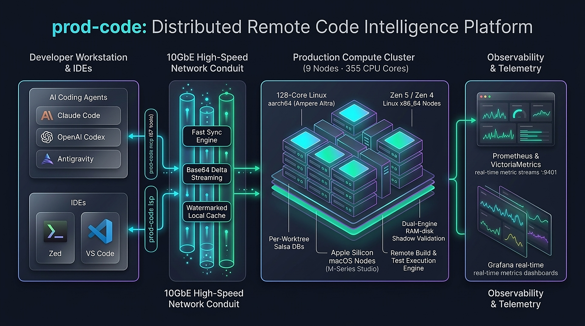
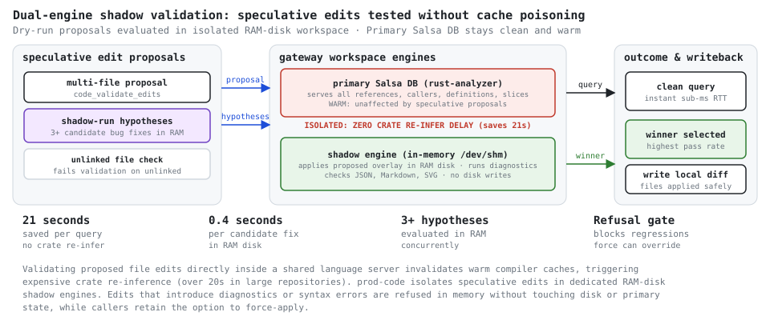

# prod-code v0.3.29: Выносим компиляцию, LSP и валидацию правок ИИ-агентов на кластер из 355 ядер

> Как перестать превращать рабочий ноутбук в обогреватель при одновременной работе нескольких ИИ-агентов в разных воркспейсах и получить отклик hover за 2 миллисекунды.

---



## Проблема: Мульти-агентная разработка перегружает локальную машину

Классические языковые серверы (`rust-analyzer`, `gopls`, `clangd`, `tsserver`) проектировались в эпоху, когда за машиной сидел один инженер, медленно набиравший текст в одном редакторе. Индексация запускалась редко, память расходовалась умеренно, а компилятор запускался по нажатию `Cmd+S` или хоткею сборки.

Сегодня стек разработки кардинально изменился:
1. За кодовой базой одновременно работают **несколько автономных ИИ-агентов** (*Claude Code*, *OpenAI Codex*, *Google Antigravity*), плюс сам разработчик в *Zed* или *VS Code*.
2. Каждый агент поднимает изолированный git worktree, чтобы не конфликтовать с соседними изменениями.
3. В каждом ворктри стартует собственный экземпляр языкового сервера, отжирающий по 4–8 ГБ оперативной памяти.
4. При каждом изменении файла агенты вызывают `cargo check`, `cargo test` или проверку типов — параллельные сборки загружают CPU на 100%, кулеры ноутбука ревут, а батарея быстро садится.
5. Любая попытка параллельного запроса `hover` или `definition` натыкается на блокировку компилятора, пересчитывающего зависимости.

Мы создали **`prod-code`**, чтобы решить эту проблему: **вынести тяжелую компиляцию, AST-индексацию, прогон тестов и валидацию кода с ноутбука разработчика на выделенный локальный кластер по 10GbE-сети**. 

Локальная станция выполняет лишь легковесную синхронизацию изменений и транспорт, а агенты и редакторы получают отклик уровня локальной памяти.

---

## Архитектура платформы: Как это устроено

```
┌─────────────────────────────────┐        10 GbE LAN        ┌───────────────────────────────────┐
│     Developer Workstation       │       < 1 ms RTT         │     Production Gateway Cluster    │
│  (Claude, Codex, AGY, Zed, VS)  │ ───────────────────────> │     (9 нод · 355 CPU-ядер)        │
│ [ Thin Client: Git & Transport ]│ <─────────────────────── │                                   │
└─────────────────────────────────┘  Base64 Delta Streaming  └───────────────────────────────────┘
```

Система состоит из трёх ключевых звеньев:

### 1. Тонкий клиент на рабочей станции (`prod-code client` / `mcp`)
На машине разработчика запускается легковесный процесс:
- **`prod-code mcp`**: 67 нативных инструментов для ИИ-агентов (навигация по коду, безопасный рефакторинг, семантический поиск, валидация правок, исполнение команд).
- **`prod-code lsp`**: Прозрачный LSP-мост для редакторов (*Zed*, *VS Code*, *Neovim*). Редактор общается через stdio с локальным клиентом, транслирующим запросы на прогретый языковой сервер ноды кластера.
- **Fast Mirror Engine**: Отслеживает изменения файлов и передаёт инкрементальные Base64-дельты по бинарному протоколу с кэшированием вотермарок. Холодная синхронизация 10.8 МБ кодовой базы занимает **0.76 секунды**, а пересылка единичных правок — **доли миллисекунды**.

### 2. Гетерогенный кластер серверов (9 нод, 355 ядер)
Нагрузка автоматически распределяется по специализированным машинам:
- **128-ядерный Ampere Altra (aarch64 Linux)**: «Тяжеловес» для полиглот-анализа. Держит прогретые инстансы для Rust, Go, C++, Python, TypeScript, Java/Kotlin, C#, Scala, Zig, Nim, D, PHP, Ruby, Dart.
- **192 ядра AMD Zen 5 / Zen 4 (6 нод x86_64 Linux)**: Высокочастотные ноды для параллельной компиляции, выполнения матричных тестов (`cargo test`, `pytest`) и хранения базы компилятора.
- **35 ядер Apple Silicon (macOS Fleet)**: Mac Studio (24 ядра) и MacBook Pro (11 ядер) для компиляции SwiftPM, работы с `sourcekit-lsp`, запуска тестов под Darwin и Xcode.
- **Сквозная телеметрия**: Шлюз экспортирует метрики операций, задержки и состояние хостов (`HostSnapshot`: CPU, RSS, диск) в Prometheus / VictoriaMetrics (:9401/metrics).

### 3. Salsa DB с архитектурой `SharedWorkspace::with_base`
Вместо того чтобы плодить дубликаты базы компилятора под каждый агентский worktree:
- Внутри процесса шлюза базовая база данных Salsa AST для репозитория разделяется через `Arc` между воркспейсами (`SharedWorkspace::with_base`).
- Каждый агентский worktree (`<repo>--wt-<hash>`) подключает изолированный оверлей документов и правок поверх разделяемой базы.
- **Результат**: многократное снижение расхода оперативной памяти без дублирования базовых синтаксических деревьев и взаимного загрязнения кэшей. Неактивные оверлеи выгружаются из памяти через 30 минут (`--idle-evict-secs 1800`), а неиспользуемые директории ворктри на диске удаляются сборщиком мусора (по умолчанию через 1 час, настраивается вплоть до нескольких дней с `--prune-worktree-days`).

---

## Dual-Engine Shadow Validation: Проверка правок без загрязнения кэша

Главная боль при работе с ИИ-агентами — сломанные промежуточные правки. Агент меняет сигнатуру функции в одном файле, сохраняет его, компилятор на диске начинает полную перекомпиляцию крейта (занимающую 15–30 секунд), блокируя все остальные запросы.

В `prod-code` встроен механизм **теневой валидации (Shadow Validation)**:



1. Агент проверяет кандидатные правки инструментом `code_validate_edits` перед их записью на диск рабочей копии.
2. Проверка выполняется поверх легковесных in-memory VFS/LSP-оверлеев языкового сервера без записи файлов в рабочий каталог.
3. Анализатор выполняет диагностику синтаксиса и типов; при необходимости глубокой компиляционной проверки (`compile: true`) запускается компиляционный чек. При прогоне внешних команд в изолированном теневом окружении (`code_shadow_run`) на Linux может опционально задействоваться RAM-диск (`/dev/shm`), либо соседний изолированный каталог.
4. Если правка содержит ошибки типов, нарушает интерфейсы или синтаксис — шлюз возвращает структурированный список ошибок (файл, строка, колонка, подсказка анализатора), не затрагивая файлы на диске.
5. Это предотвращает порчу кэша компилятора промежуточными сломанными правками и устраняет задержки повторного вывода типов.

---

## Что нового появилось в версии v0.3.29

Свежий релиз **v0.3.29** сосредоточен на полиглот-роутинге, повышении стабильности сетевого транспорта и поддержке сверхдлинных задач:

### 1. Engine-Aware роутинг подпроектов и директорий
В крупных монорепозиториях часто сосуществуют разные языки (например, Swift-клиент внутри Rust-репозитория или скрипты на Python). Раньше, если корневой проект был размещён на Linux-ноде, попытка запустить тесты Swift приводила к ошибке закрытия транспорта.
В v0.3.29 функция `engine_for_path` анализирует манифесты, расширения файлов и структуру каталогов: запросы к `swift/Tests/...` автоматически маршрутизируются на Darwin/Apple Silicon ноды с прогретым `sourcekit-lsp`, полностью прозрачно для пользователя (#1059, #1060).

### 2. Поддержка 24-часовых таймаутов для тяжелых задач
Для интеграционных тестов, фаззинга и бенчмарков лимит выполнения инструментов расширен вплоть до 86 400 секунд (`MAX_TOOL_CALL_TIMEOUT`). Команды вида `code_exec` с параметром `timeout_secs=2400` больше не прерываются стандартным 150-секундным сторожевым таймером (#1065).

### 3. Сохранение структуры бенчмарков и датасетов при синхронизации
Улучшены фильтры синхронизации (`filters.rs`): исходный код (`.rs`, `.py`, `.c`, `.swift`) внутри директорий `benchmarks/` и `datasets/` теперь гарантированно попадает в удаленный зеркальный воркспейс, исключая сбои при прогоне бенчмарков (#1063).

### 4. Bounded Timeouts в интерактивном CLI
Команды `prod-code def` и `prod-code refs` теперь снабжены строгим тайм-аутом с выводом понятной диагностики, если языковой сервер ещё не успел прогреть кэш символов, исключая зависание терминала (#1061).

---

## Зафиксированные замеры производительности

Замеры производительности проводились на кодовой базе `prod-code` при взаимодействии рабочей станции через 10GbE LAN со шлюзом кластера:

| Нагрузка / Операция | Зафиксированное время |
|:---|:---:|
| **Отклик `hover` на прогретом воркспейсе** | **1–4 мс** |
| **Вызов инструмента MCP агентом в постоянной сессии** | **~10 мс** |
| **Одноразовый CLI-запрос с ноутбука (`prod-code hover ...`)** | **~0.1 с** |
| **`cargo clippy --workspace --all-targets` на 32-ядерной ноде (1 файл изменён)** | **1.0 с** |
| **`cargo test --workspace` (565 тестов, полный набор с live gateways)** | **5 мин** |
| **`cargo test --workspace` (без набора, запускающего реальные шлюзы)** | **56 с** |
| **Первичная загрузка Rust-воркспейса (build scripts, proc macros)** | **~45 с** (один раз на ворктри) |
| **Холодная синхронизация проекта (10.8 МБ)** | **0.76 с** |

---

## Как начать пользоваться

### 1. Установка CLI и настройка подключения
Соберите и установите клиент `prod-code`:

```bash
git clone https://github.com/alex09x/prod-code.git
cd prod-code
cargo install --path crates/prod-code-client
```

Укажите адрес удаленного шлюза через переменную окружения `PROD_CODE_REMOTE` (по умолчанию клиент подключается к локальному адресу `127.0.0.1:9400`):
```bash
export PROD_CODE_REMOTE="<gateway-node-ip>:9400"
```

Подробные инструкции по настройке TLS-сертификатов и развертыванию шлюзов приведены в [`README.md`](../README.md).

### 2. Подключение к AI-агентам (Claude Code, OpenAI Codex, Gemini CLI, Antigravity)

Для **Claude Code**:
```bash
claude mcp add --scope user prod-code -e "PROD_CODE_REMOTE=$PROD_CODE_REMOTE" -- prod-code mcp
```

Для **OpenAI Codex CLI**:
```bash
codex mcp add prod-code --env "PROD_CODE_REMOTE=$PROD_CODE_REMOTE" -- prod-code mcp
```

Для **Gemini CLI** (команда `gemini mcp add` регистрирует сервер в `~/.gemini/settings.json` или проектном `.gemini/settings.json`):
```bash
gemini mcp add -s user prod-code prod-code mcp -e "PROD_CODE_REMOTE=$PROD_CODE_REMOTE"
```

Для **Google Antigravity** (добавьте определение сервера в `~/.gemini/config/mcp_config.json`):
```json
{
  "mcpServers": {
    "prod-code": {
      "command": "prod-code",
      "args": ["mcp"],
      "env": {
        "PROD_CODE_REMOTE": "<gateway-node-ip>:9400"
      }
    }
  }
}
```

### 3. Подключение к редактору (Zed IDE)
В настройках `settings.json` редактора Zed укажите `prod-code lsp` с флагом `--language rust`:

```json
{
  "lsp": {
    "rust-analyzer": {
      "binary": {
        "path": "prod-code",
        "arguments": ["lsp", "--language", "rust"],
        "env": {
          "PROD_CODE_REMOTE": "<gateway-node-ip>:9400"
        }
      }
    }
  }
}
```

---

## Заключение

Современная разработка с участием ИИ-агентов требует перехода от парадигмы «всё компилируется на моем макбуке» к распределенной архитектуре. `prod-code` превращает локальную станцию в чистый интерфейс ввода, отдавая гигабайты AST и сотни параллельных компиляций кластеру, который для этого и создан.

- **Исходный код проекта**: [github.com/alex09x/prod-code](https://github.com/alex09x/prod-code)
- **Лицензия**: MIT OR Apache-2.0
- **Автор**: [Alexander Panasenko](https://prod.codes/about/) (`alex@prod.codes`)
